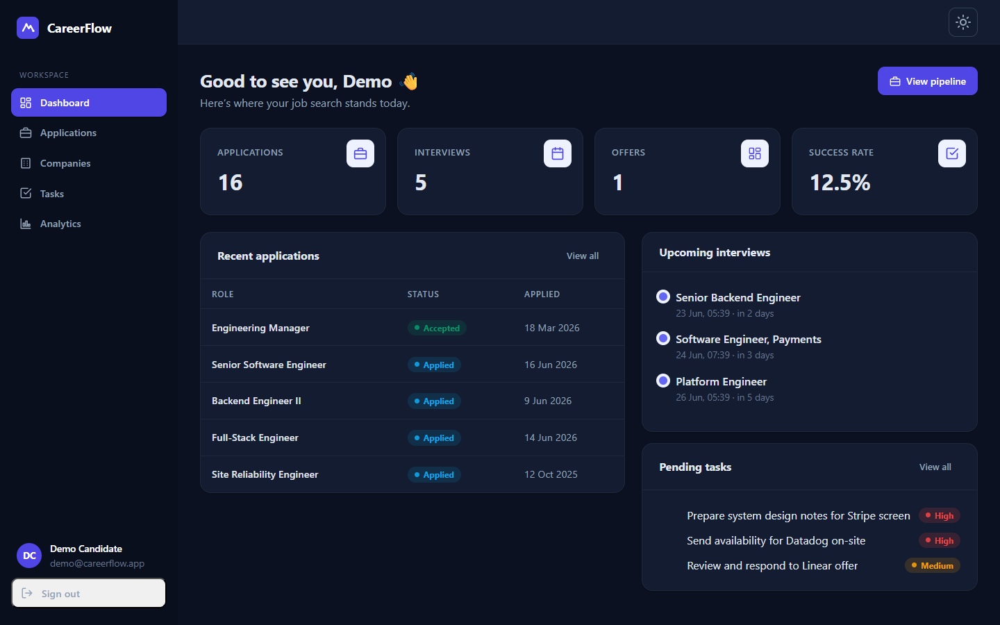
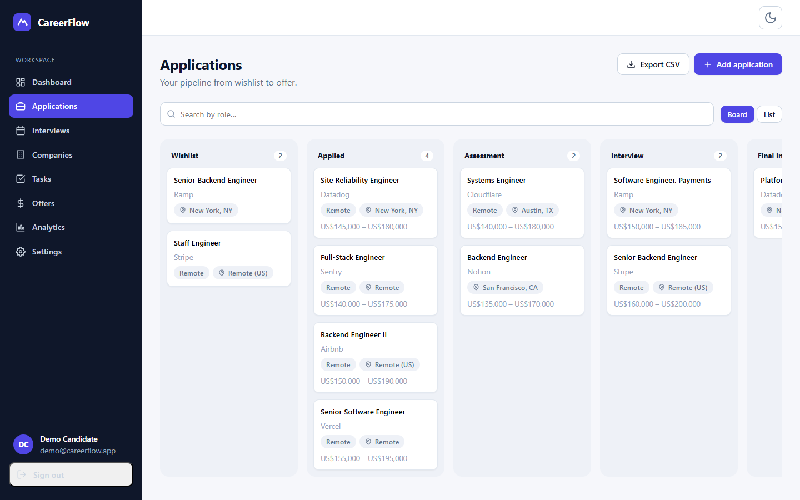
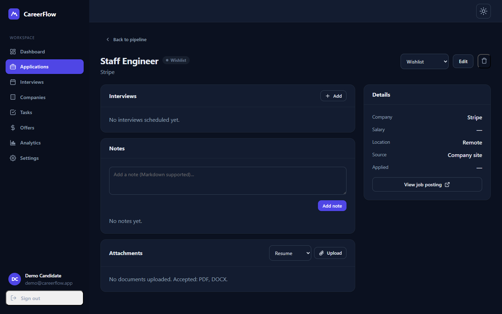
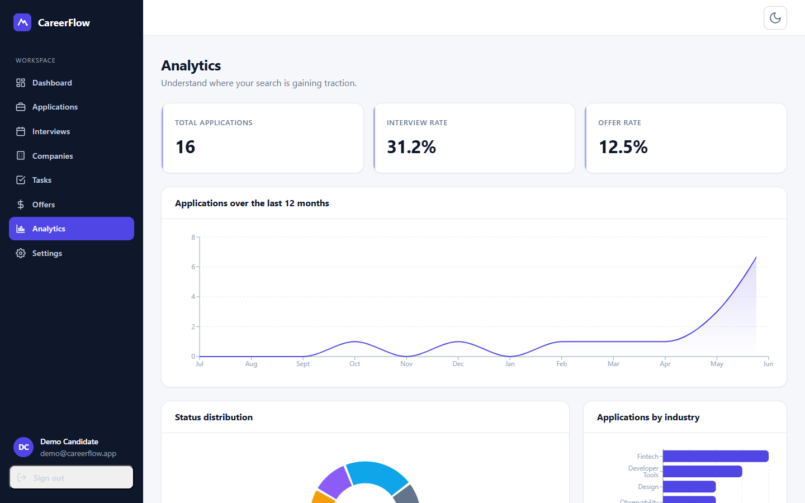
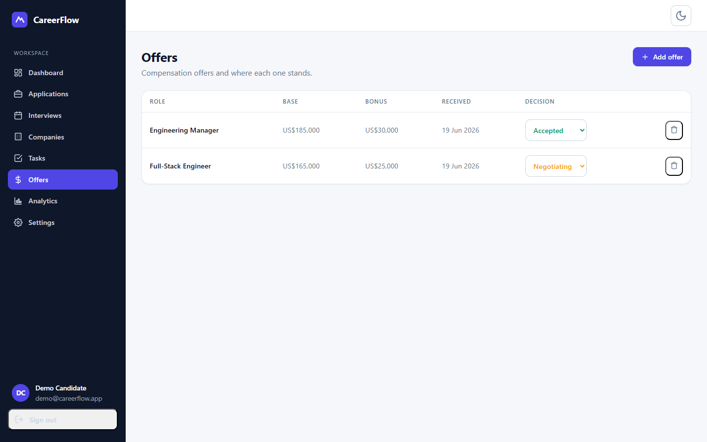
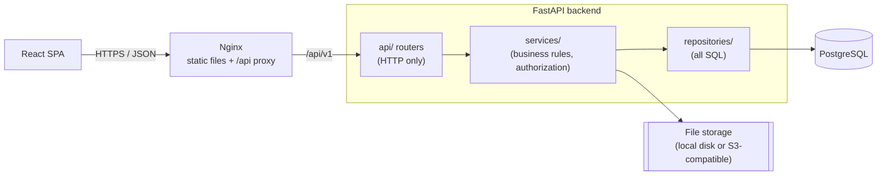

# CareerFlow

A job-search tracker. It keeps every application, interview, task and offer in one place instead of a spreadsheet and an inbox.

Full-stack web app: FastAPI and PostgreSQL on the backend, React and TypeScript on the frontend, installable as a PWA.


[](LICENSE)



**Live demo:** [frontend-jade-two-zfchqjb5ws.vercel.app](https://frontend-jade-two-zfchqjb5ws.vercel.app) — press **Try demo** on the login screen, no signup needed
(demo account: `demo@careerflow.app` / `DemoPass123!`, seeded with sample data).
The API runs on a free hosting plan, so the first request after a quiet period can be slow.

## Features

- **Pipeline** — applications move through eight stages (Wishlist → Applied → Assessment → Interview → Final → Offer → Rejected → Accepted), shown as a Kanban board or a sortable list.
- **Per application** — interview rounds, offers (salary, bonus, equity, decision), tasks with due dates, Markdown notes and file attachments.
- **Companies and contacts** — recruiters, hiring managers and referrers, linked to companies.
- **Dashboard** — headline stats, upcoming interviews, pending tasks, and charts for applications over time, status and industry breakdown, and conversion rates.
- **CSV export** of the whole pipeline.
- **Document vault** for CVs and certificates.
- **Job search** through the Adzuna API with saved filters, plus a match score between a posting and one of your CVs that lists the skills the posting asks for and the CV is missing. The score is rule-based, so it needs no external service.
- **CV tailoring** for a specific posting through the OpenAI API, saved as a new CV version. Without an API key it falls back to an offline stub.
- **Interview prep** — a question bank with your prepared answers, tagged by topic.
- **Auth** — email/password, bcrypt hashing, short-lived JWT access tokens and refresh tokens. Every query is scoped to the logged-in user.
- Responsive layout (sidebar becomes a drawer on phones), light and dark themes, installable as a PWA.

## Screenshots

| Pipeline board | Application detail |
| --- | --- |
|  |  |
| **Analytics** | **Offers** |
|  |  |

## Tech stack

| Layer | Technologies |
| --- | --- |
| Frontend | React 18, TypeScript, Vite, React Router, TanStack Query, Recharts |
| Backend | Python 3.11/3.12, FastAPI, SQLAlchemy 2.0, Alembic, Pydantic v2 |
| Database | PostgreSQL 16 |
| Auth | JWT (PyJWT), bcrypt, rate limiting with SlowAPI |
| DevOps | Docker, Docker Compose, Nginx, GitHub Actions |
| Quality | pytest, Vitest, Ruff, mypy, ESLint, Bandit, pip-audit |

## Run it locally

With Docker:

```bash
git clone https://github.com/Joun-Mikhail/careerflow.git
cd careerflow
docker compose up --build
```

- Web app: http://localhost:5173
- API docs (Swagger): http://localhost:8000/api/docs
- Health check: http://localhost:8000/health

The backend runs the database migrations and creates the demo account on first start.

Without Docker:

```bash
# Backend (Python 3.11+)
cd backend
python -m venv .venv && source .venv/bin/activate
pip install -e ".[dev]"
cp .env.example .env
alembic upgrade head
uvicorn app.main:app --reload

# Frontend (Node 20+), in a second terminal
cd frontend
npm install
npm run dev
```

## Architecture



The backend is split into layers: routers only handle HTTP, services hold the business rules and ownership checks, and repositories do all database access. In production Nginx serves the built frontend and proxies `/api` to the backend, so the browser talks to a single origin.

More detail: [architecture](docs/02-technical-architecture.md), [database design](docs/03-database-design.md), [API design](docs/04-api-design.md).

## Tests and CI

```bash
cd backend
ruff check . && mypy app
pytest --cov

cd frontend
npm run lint && npm run typecheck && npm test
```

The backend tests run against in-memory SQLite. Production uses PostgreSQL.
On every push, CI runs linting, type checks, Bandit, pip-audit and both test suites, builds both Docker images, and fails if backend coverage drops below 80%.

## Security

- Each user only sees their own data. Requests for another user's records return `404`.
- Passwords are hashed with bcrypt, and login errors don't reveal whether an email exists.
- Login, token refresh and password change are rate-limited.
- Uploads are checked for type and size and stored under random names outside the web root.

Details: [security design](docs/05-security-design.md).

## Known limitations

- One user per account, with no shared workspaces.
- Used refresh tokens are not revoked yet, so a stolen refresh token stays valid until it expires.
- Application attachments are stored on local disk. Only the document vault (CVs, certificates) can use S3-compatible storage.
- The board has no drag-and-drop yet. Status is changed from the application.
- The iOS and Android builds (Capacitor) are set up but not published to the app stores.

## Roadmap

- [x] Applications, interviews, tasks, notes, attachments
- [x] Dashboard and analytics
- [x] CSV export
- [x] Docker setup and CI
- [ ] Drag-and-drop on the pipeline board
- [ ] Revoke refresh tokens after use
- [ ] S3-compatible storage for application attachments
- [ ] Email or calendar reminders for upcoming interviews
- [ ] Full-text search across notes

## Deployment

Deployment guides for Vercel + Railway + Neon, Render (`render.yaml`) and Heroku (`app.json`) are in [docs/deployment.md](docs/deployment.md) and [docs/deploy-runbook.md](docs/deploy-runbook.md). In production the app refuses to start with the placeholder `JWT_SECRET`.

## License

[MIT](LICENSE) © 2026 Joun Mikhail
